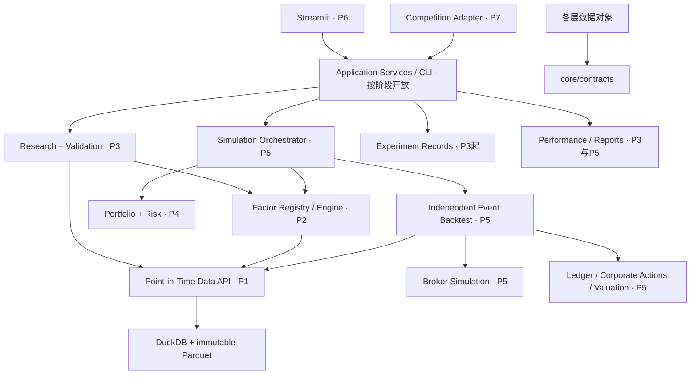

# 系统架构提案

关联：GOV-001、ARCH-001–003、DATA-001–013、FACTOR-001–012、INT-001–006。本文件无业务实现。

## 分层和允许依赖

箭头表示调用方依赖服务，不表示事件发生顺序。core/contracts 只含数据契约，不导入任何业务模块。

`Simulation Orchestrator` 是应用服务内部编排；向回测注入仅含已批准信号的 provider。回测只消费 SignalBatch、TargetPortfolio、RiskDecision、Order/Fill 等契约，不导入 Registry 具体插件、不识别 Momentum 等名称。Portfolio 不调用回测；回测通过协议调用组合/风险，避免双向循环。报告只读取产物，不改账户。Experiment 保存配置/事件/产物引用，不参与金融计算。

| 模块 | 责任 / 所有权 | 输入→输出 | 首次阶段 |
|---|---|---|---|
| Data Layer | 标识、PIT 查询、日历、质量、快照 | 源数据→受时间约束数据视图 | P1 |
| Factor Registry / Engine | 审核元数据、版本、只读受限计算 | DataView + FactorRef→原始 SignalBatch | P2 |
| Research | 有版本的处理链、算子、缓存 | 原始信号→分阶段分数 | P3 |
| Validation | 标签、IC、显著性、分层、OOS | 研究分数+可见标签→研究证据 | P3 |
| Portfolio | 因子无关权重和目标持仓 | 已批准分数+账户→TargetPortfolio | P4 |
| Risk | 所有目标及实际订单的独立限制 | 目标/订单+市场约束→批准/拒绝及原因 | P4/P5接线 |
| Backtest | 事件调度与回放 | 契约化事件→审计事件流 | P5 |
| Broker Simulation | 状态机、执行模型、部分成交 | 合法订单+执行切片→Fill/拒绝 | P5 |
| Ledger | 唯一现金持仓写入者、幂等记账 | 成交/行动/现金流→AccountState | P5 |
| Performance & Reporting | 统一财务/统计口径，只读 | 研究证据/账本→报告 | P3/P5 |
| Experiment Management | 不可变配置、运行血缘、失败记录 | 运行事件→索引+产物 | P3（P1数据清单） |
| Application Services | 校验、任务状态、编排、幂等 | RunRequest→RunReceipt/Results | 逐阶段，P6接口完整 |
| Streamlit | 用户输入、展示、日志 | 表单→同一应用请求 | P6 |
| Competition Adapter | 明示映射规则/能力边界 | 比赛规范→标准输入输出 | P7，规则外部依赖 |

## 包布局提案

未来 `src/aqrp/{core,data,factors,research,validation,portfolio,risk,backtest,execution,performance,experiments,services,cli,ui,competition}`；本次不创建这些包。每项未来文件/测试由 REQUIREMENTS 追踪。函数依赖按协议注入；不使用全局可变账户/因子选择。日频单进程确定性运行先行；不加入消息队列、微服务或分布式调度。

统一 returns/排名等数学原语放 core/math，但验证答案保存在独立测试资料中，不能从此处反算。DuckDB 是可重建索引/查询层，Parquet 快照与 manifest 为持久版本边界。实验产物目录按 run_id 隔离，不覆盖历史。缓存键含代码/数据/配置/股票池/PIT/处理链哈希，不能跨时间权限复用。

Research Mode 允许候选版本，Strategy Mode 仅允许批准清单中的精确代码哈希、Factor API 和数据契约版本。候选修改不会改变策略 pin。批准状态保存在独立只追加审批记录，不在插件自报字段中信任。Research 的标签 store 不暴露给信号 provider。

不可信代码依靠独立进程/OS 沙箱、无网络凭证及只读快照边界；Python 协议和 AST 检查不能构成隔离。具体隔离实现待 DECISIONS D-006；未实现前只运行已审查随库因子，不支持网页上传任意插件执行。

已批准契约破坏性变更提高 major 版本、提供迁移/影响表和新旧适用兼容测试；旧实验始终 pin 原版本，不能静默升级。所有跨层接口的时间、单位和错误见 INTERFACES、DATA_CONTRACT、BACKTEST_CONTRACT。
