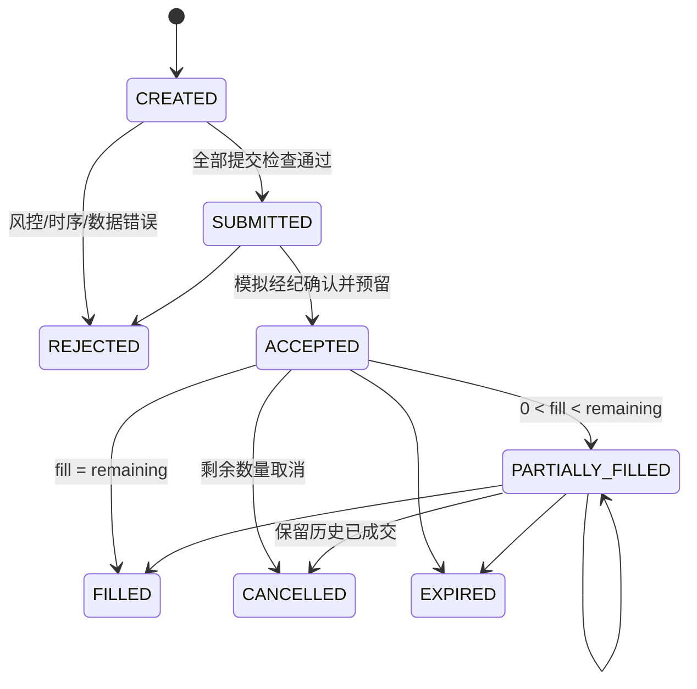

# 回测事件、订单及账本契约 backtest/1.0.0（提案）

关联 BT-001–010、PORT-001–004、RISK-001–004、QA-003。Phase 0 定义；Phase 5 实现自动测试及已知答案，不提前建引擎。

## 时序

总排序键 `(logical_time_utc, phase_priority, sequence_id)`。相同时间的先后由明确优先级决定；唯一 event_id、causation_id、run_id，回放不得用本机时间或随机容器遍历顺序排序。事件不可改写，重复 event_id 幂等，不同内容同 ID 失败。

日频默认：t 日收盘行情确认 → 该数据 available_at 以后生成信号 → decision_time 组合决策 → 风控 → 提交下一交易日订单 → t+1 最早允许执行切片 → 成交 → 原子记账 → 估值。任何环节延迟至 t+1 开盘之后则顺延到下个允许切片，不能倒填开盘成交。

必要不等式：`max(input.available_at) <= signal.available_at <= decision_time <= order.submitted_at <= order.eligible_at <= fill.execution_time`。信号的 logical signal_time（所属 session）不能代替 available_at。执行切片由 exchange calendar 和下单截止规则计算，不是简单加一天。没有可用信号不能创建可执行订单；预置调仓意图不是订单。

| 同一逻辑时点优先级 | 事件 | 约束/产物 |
|---|---|---|
| 10 | 公司行动/到期结算 | 按已公告且生效的行动调整；拆股、应收及现金结算独立事件 |
| 20 | MarketConfirmed | 明确 OPEN_EXECUTION 或 CLOSE_CONFIRMED；仅开放该切片可见字段 |
| 30 | SignalGenerated | 只读 PIT DataView，不读取执行日完整 OHLCV |
| 40 | PortfolioDecision | 以先前提交完成的账户状态和可见信息构建目标 |
| 50 | RiskChecked | 目标检查及提交前检查；不可行/缺证据明确拒绝 |
| 60 | OrderSubmitted / Accepted | 合法信号、profile、现金/可卖数量预留，限定未来 eligible 切片 |
| 70 | Match | 仅匹配此前已合格订单；再次检查状态、资金、借券及限价 |
| 80 | Fill | 固定实际价格、数量、成本、订单与切片引用 |
| 90 | AccountUpdated | 一笔成交全部原子记账，然后才允许处理下一订单/Fill |
| 100 | Valuation | 同时点所有成交/现金流完成后估值，标 mark 来源与 stale |

逻辑时间为收盘时，Match 不可为此时新生成信号匹配同日收盘；需 eligible_at 下个允许切片。开盘决策看不到未来整日量；历史 open 是模拟执行参考价，不能回传给前日决策。多订单按提交时间、稳定 order_id 顺序执行，预留资金避免同时超买。当天的 Fill→AccountUpdated 是逐笔原子对，不先集中全体 Fill 后再一起记账。

默认 open 模型：昨收后已提交订单参考下一 session 原始 open，买价=open*(1+slippage_bps/10000)，卖价=open*(1-slippage_bps/10000)，按 profile tick/限价处理。流动性上限使用下单前可见的历史 ADV 和实际执行切片可用容量，不能使用当天最终 volume；无真实开盘容量时使用明确的合成固定容量并在报告标注模型假设。停牌、缺 open、涨跌停/无卖盘等按已批准 profile 拒绝/延期，不假定全额成交。

## 订单状态机

终态 REJECTED/FILLED/CANCELLED/EXPIRED 不再成交；撤单以取消确认先于后续撮合为准。CREATED 尚非可执行订单。remaining=original-filled-cancelled，数量非负且按 lot 对齐；fill_qty 不超过 remaining 或切片容量；累计成交与费用不能因取消丢失。重试用幂等键，禁止重复扣款。DAY 期限默认，GTC/限价等仅在相应 profile 已实现时开放，否则 UnsupportedOrderType。

## 账本

唯一写入者 Ledger；追加不可变 Journal（entry_id、事件/成交/行动引用、币种、借贷科目、Decimal 金额、数量变更、成本变更）。每事件各币种借贷平衡，事务提交或完全回滚。独立审查从原始 Fill/现金流重建账户，不能拿 AccountState 的输出反证自身。

单币种现金：`cash_after = cash_before - signed_qty*fill_price - fee + settled_cashflow`（买 signed_qty>0，卖<0）。预留现金不再重复扣现金：available_cash=cash-reserved_cash-其他冻结；非杠杆现金账户不得为负。交收限制以独立 settled/unsettled 余额和可售数量表示，不把应收当作立即可买资金。

`equity = cash + sum(signed_position*raw_mark) + receivables - payables`；冻结仍属现金；借贷/融资负债单列。拆股改变数量/单位成本，分红应收转现金不会再次改变权益。未实现盈亏按已定义成本法（建议移动加权平均）与当前 mark；已实现盈亏减卖出成本、报告费用单列并净额对齐，禁止费用双扣。MVP 不支持跨币种或未定义的税务处理。

首批 Golden 情景：买入(1000−2×100−1=799；2×105=210；权益1009)、卖出、部分成交、资金不足、手续费最小额/舍入、重复 Fill、拆股、分红应收与支付、退市缺估值；Long-Short 在 P4 定义、P5 补空头保证金/借券/股息应付/费用测试，缺已批准规则必须 Unsupported，不声称完整多空回测已验收。

不变量：现金持仓权益对账、费用守恒、无重复现金流、无非法状态、无未来订单、无负可用现金/违规卖空、拆股前后权益连续、外部注资不计收益。内部盈亏与费用应可归因，多空贡献相加与净损益一致。

## 绩效口径

保存每日现金/持仓/权益、订单、Fill、费用、风险暴露与多空归因。外部现金流默认分段 time-weighted return；无外部流时 `r_t=E_t/E_(t-1)-1`。累计为 prod(1+r)-1；年化=(1+累计)^(A/n)-1，n 为有效 session 间隔，A 明示日历假设；非正权益年化标 undefined。

波动率=std(r,ddof=1)*sqrt(A)；Sharpe=mean(r-rf_daily)/std(r-rf_daily,ddof=1)*sqrt(A)，无风险转换与 A 固定，样本不足/方差0标 undefined。最大回撤=max(1-E_t/running_peak)，含初始权益。换手分别报告 sum(abs(fill_notional))/当期决策前权益 的双边口径及其半值，不混用；交易成本按费用+滑点归因，净收益不得再扣已入账费用。序列相关需另提供稳健统计，不用年化数字掩盖。详细统计定义见 RESEARCH_PROTOCOL。
