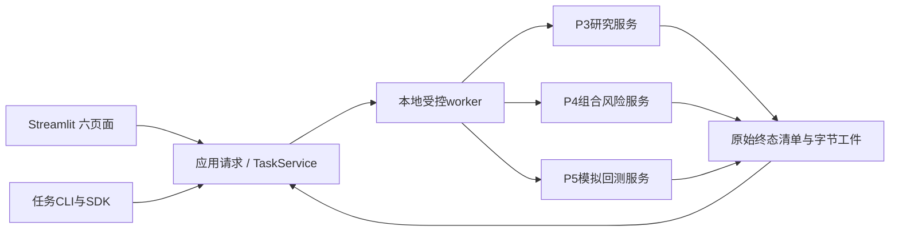

# Phase6 G1 计划 · 六页面与统一应用入口

起点为已发布 main / phase5-baseline / v0.5.0 `59246f9fd391c1713b6bed65dd22280f4d248493`。PR #8 已验收合并，Phase5 G2 固定 1c5a7e6 与归档头 c43b594、普通合并 36c2691、发布登记提交分别追溯于 PHASE5_RELEASE_RECEIPT。Phase5 合并后 SDK1158、原20+4/91和原始工件仅是前置回归，不是本阶段实现证据。

本阶段原目录恰好 **8项（5 MVP / 3 Competition Ready）**：UI-001–006 六页面，UI-007 三入口一致性，UI-008 统一任务/日志/图表。不得缩成只做页面外壳，也不得添加 P7 比赛接口、部署、多用户平台、真实源/账户、自动因子代码上传或新的金融算法。当前只申请 G1；全部本阶段能力为 Planned，未实现，不以样例截图或 mock 输出冒充实际研究/回测。

实现后的单一链路：Streamlit 薄视图 / 新任务CLI / SDK → 同一请求规范化与 TaskService → 现有 P3 ResearchRequest/research、P4 PortfolioRequest/construct_engineering、P5 EngineeringBacktestRequest/simulate_engineering/result/replay → 原有不可变账本与真实工件。旧 aqrp-research / aqrp-backtest 公共CLI保持兼容，并纳入相同请求、同核与数值对照。页面不实现统计、组合、风险、撮合、记账或绩效算法。

拟实施顺序（仅在 G1 通过且用户另行授权实现后）：(1) 固定UI扩展依赖与准入/环境证据；(2) catalog、有效请求、TaskService、持久化幂等与生命周期；(3) 六页面及原始工件视图；(4) CLI/SDK/UI全研究与回测一致、因子替换；(5) 完整SDK/双OS原ZIP/真实本地浏览器证据和固定SHA G2。任何一步失败保存原始结果，不跳过阶段依赖。

工程用途必须显式为 ENGINEERING_TEST_ONLY。正式策略入口继续后端 APPROVAL_REQUIRED，FINAL_TEST 无网页入口且后端拒绝；既有真实隔离/金融批准/正式Test/完整历史宿主边界继续保留。G1不产生实施、阶段验收或发布许可。

G1固定f7a1a68独立审查为PLAN BLOCKED（001High、002/003Medium）。本轮只修订：三kind全Task完成屏障、P5内部逐决策P4的可信上下文/原物理根/恢复与重放、整数精确数值参考及边界。详g1-f7a1a68/DEVELOPER_RESPONSE、TASK_COMPLETION_CONTRACT、NESTED_CONTEXT_CONTRACT、NUMERIC_REFERENCE_CONTRACT。原8需求/32答案/依赖候选/core锁/P5发布不改；三项待新固定SHA独立复核，不宣告关闭。
